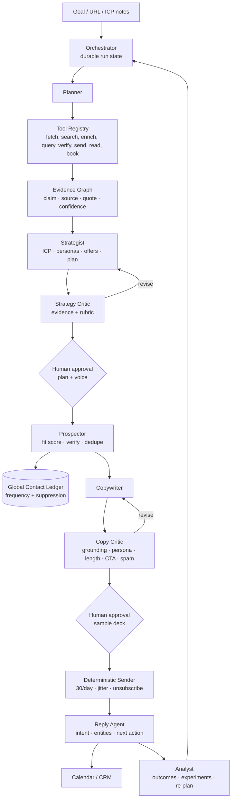

# AutoGTM — Autonomy & Gap Analysis

**Date:** 2026-10-30  
**Scope:** `E:\Projects\autogtm` at commit `c2e57a3`, production `autogtm.tech`  
**Question:** What were we actually supposed to build, what did we actually build, and how do we reach a genuine autonomous agentic harness?

---

## 0. Executive Verdict

AutoGTM today is **a deterministic outbound workflow engine with LLM-assisted research, strategy, and copywriting**. It is deployed, it sends real email, it syncs real replies, and it enforces real sending caps. That part is not fake.

It is **not an autonomous agentic harness**.

The system has no planner, no tool-selection loop, no persistent memory, no evaluator/critic, no self-correction, no cross-run learning, and no autonomous re-planning. The "agent" is a five-step wizard with three single-shot LLM calls behind it. The marketing describes a self-driving GTM operator; the code is a well-built campaign pipeline.

That is not nothing. The deterministic backbone is the hardest part to get right, and it mostly is right. The intelligence layer is the part that is still a prototype wearing production clothes.

### Autonomy maturity

| Level | Description | AutoGTM |
|---|---|---|
| **L0** | Static templates and rules | — |
| **L1** | Single-shot LLM generation | — |
| **L2** | Deterministic workflow with LLM nodes + human gates | **← current** |
| **L3** | Tool-using agent with planning, evidence, and evaluation; human approval at key gates | target near-term |
| **L4** | Closed-loop optimization: experiments, reply handling, re-planning, guardrails | target mid-term |
| **L5** | Self-directed multi-channel GTM operator with budget authority | not advisable soon |

**Current: L2. Realistic next target: L3. Long-term: L4.**

---

## 1. What We Were Actually Supposed to Build

### 1.1 The product thesis

From the original handover and public positioning:

- A founder enters **one URL**.
- AutoGTM crawls the company, infers positioning, builds an ICP, finds verified buyers, writes bespoke outbound, calibrates voice through swipes, and launches multi-touch email.
- **$0/month software**, **5¢ per delivered email**, no seats, no burner domains, no DNS setup, no warmup wait.
- **100M+ verified B2B leads**, pre-warmed shared mailbox mesh, 30 emails/mailbox/day, 45–120s jitter.
- **UniBox** with two-way IMAP, sentiment triage, auto-stop on reply, and one-click calendar booking.
- The whole thing should feel like an **autonomous GTM operator**, not a campaign editor.

### 1.2 The eight pillars

1. Single URL entry.
2. Deep autonomous scraping and company research.
3. Collaborative strategy board (ICP + offers).
4. B2B lead extraction from the directory.
5. Tinder-style swipe calibration.
6. Velocity and daily budget slider.
7. Shared mailbox dispatch mesh.
8. Mission Control + two-way UniBox.

### 1.3 What "agentic harness" should mean here

An agentic harness is not "a prompt that returns JSON." It is a runtime that can:

1. **Take a goal** ("book 10 meetings for Ledgerline in 30 days").
2. **Plan** the work into research, strategy, prospecting, copy, launch, and monitoring steps.
3. **Choose and call tools** (web fetch, search, enrichment, lead query, email verify, DNS check, send, IMAP read, calendar, CRM).
4. **Observe results** and update its state.
5. **Evaluate its own output** against a rubric and evidence.
6. **Revise** when the evaluation fails.
7. **Remember** what worked across runs, leads, and workspaces.
8. **Re-plan** when campaign data changes.
9. **Operate inside hard guardrails** (caps, suppression, contact frequency, approval gates, budget).
10. **Be traceable** — every step, tool call, prompt, response, cost, and decision is auditable.

The current system satisfies #1 partially and #9 partially. It does not satisfy #2–#8 or #10.

### 1.4 The product promise contains a tension

Two claims pull in opposite directions:

- "Enter only your URL. Live in 60 seconds. Zero human intervention."
- "Review the strategy board. Swipe 10 emails. Set velocity."

The honest synthesis is: **human-in-the-loop calibration, autonomous execution**. The product should reduce the human's job to approving a plan and a voice, not operating a wizard. The current implementation exposes every internal step as a manual gate, which is the opposite of an operator experience.

---

## 2. What Is Actually Built (Evidence Map)

| Layer | Primary files | What it actually does | Autonomy |
|---|---|---|---|
| Landing + auth | `apps/web/app/page.tsx`, `(auth)/*`, `lib/auth.ts` | Marketing site, Better Auth, sessions | n/a |
| Workspaces | `lib/workspaces.ts`, `lib/session.ts` | Multi-tenant isolation | deterministic |
| Crawler | `lib/gtm-crawler.ts` | Static fetch + Cheerio; headless Chromium fallback; pricing/proof/competitor extraction; SSRF guard | deterministic |
| Strategy synthesis | `lib/chad-gtm-research.ts` | **One** LLM prompt returns company, ICP, personas, offers, proof, pricing | single-shot LLM |
| Strategy board | `components/chad-gtm/strategy-review.tsx` | Editable overview, ICP, offer tabs | human UI |
| Lead directory | `lib/leads-directory.ts`, `data/leads.db` | 10.2M-row SQLite, FTS5, facets, CSV ingestion | deterministic |
| Lead matching | `lib/chad-gtm-actions.ts` | Industry + title SQL/FTS filters, offset rotation, industry fallback | deterministic |
| Swipe calibration | `components/chad-gtm/swipe-card.tsx`, `lib/chad-gtm-actions.ts` | Deck, approve/reject reasons, mid-deck adaptive generation, prompt exemplars | LLM-assisted |
| Campaign provisioning | `lib/chad-gtm-actions.ts` | Creates list, leads, template, campaign, fixed 3-step sequence, sender bindings | deterministic |
| Scheduler | `packages/email-engine/src/scheduler.ts` | Claims campaign leads, assigns senders, 45–120s jitter, daily caps | deterministic |
| Processor | `packages/email-engine/src/processor.ts` | Atomic send reservation, SMTP, List-Unsubscribe, threading, retries | deterministic |
| IMAP/UniBox | `packages/email-engine/src/sync-replies.ts`, `app/(app)/unibox/*` | Polls IMAP, strips quotes, regex sentiment, auto-stop, manual reply composer | rules + human |
| Admin pool | `app/(app)/admin/*`, `components/chad-gtm/admin-pool-view.tsx` | CSV import, capacity recommendation, pause/activate | deterministic |
| Telemetry | `app/api/telemetry/live/route.ts` | Live counts from Postgres/SQLite | deterministic |
| Deployment | `scripts/deploy_remote_chadgtm.py`, PM2, Caddy | Build, restart, TLS | deterministic |

### 2.1 What is genuinely strong

- **The sending engine is real.** Atomic 30/mailbox/day reservation, 45–120s jitter, suppression, RFC 8058 headers, `References` threading, retries, stuck-job recovery, pause/resume.
- **The IMAP layer is real.** Real mailbox sync, quote stripping, auto-stop on reply, stale flag recovery. All 11 production mailboxes now sync `ok`.
- **The data layer is real.** 10,227,232 leads, FTS5, 35–360 ms warm queries, streaming ingestion, facet cache.
- **The crawler is real.** Static + headless fallback, pricing/proof/competitor extraction, SSRF protection.
- **The product shell is real.** Auth, workspaces, admin pool, mission control, UniBox, deployment, tests, 267 passing tests.
- **The LLM layer is real but thin.** It generates specific, grounded copy when it works; it has JSON repair, spintax, and adaptive calibration.

### 2.2 What is actually LLM-driven

Only four places:

1. `synthesizeGtmStrategy()` — one prompt for the entire strategy.
2. `generateEmailScriptOnTheFly()` — one prompt per lead email.
3. `refineGtmCalibrationAction()` — one prompt to turn swipes into a voice profile.
4. `improveEmailCopy()` — one prompt in the classic template editor.

Everything else — lead selection, sequencing, scheduling, caps, sentiment, warmup, booking — is code or regex.

---

## 3. Is It Agentic? The Honest Test

| Agentic property | Current evidence | Status |
|---|---|---|
| Explicit goal | URL + optional notes; no target outcome, quota, or budget | **Partial** |
| Plan decomposition | One prompt returns a JSON strategy; no plan graph or step list | **No** |
| Tool selection | Tools are hardcoded function calls; the model cannot choose | **No** |
| Observation loop | Crawl once; no iterative fetch/search/verify | **No** |
| Memory | Run JSON + approved samples; no cross-run style or outcome memory | **Partial** |
| Evaluator / critic | Human swipe deck only; no rubric, no model critique | **Partial (human)** |
| Self-correction | JSON repair; no content revision after critique | **No** |
| Re-planning | Fixed 3-touch cadence; no response to campaign data | **No** |
| Guardrails | Caps, suppression, unsubscribe, approval gates | **Yes (sending)** |
| Traceability | DB rows for jobs/replies; no prompt/tool/step traces | **Partial** |
| Autonomy | 4+ human gates: strategy, industries, swipes, velocity | **No** |

**Conclusion:** This is a linear workflow with LLM nodes. Calling it an "agentic harness" is inaccurate. Calling it an "LLM-assisted outbound workflow engine" is accurate.

That distinction matters because the next investment should not be "more prompts." It should be **state, tools, evaluation, memory, and a contact ledger**.

---

## 4. Hardcoded / Simulated / Misleading Inventory

This is the part that deserves blunt language.

### 4.1 Hardcoded copy fallback that invents facts

`packages/email-engine/src/ai.ts` → `simulatePersonalizedScript()`

- ~300 lines of vertical-specific copy for inbox infrastructure, web design, hiring, sales, local services, etc.
- Contains invented claims such as "4-second layout delay", "30% of mobile traffic", "99% primary domain reputation".
- It runs silently when the AI call fails (`console.warn` only).
- Nothing verifies those claims against the crawl or the lead.

**Risk:** a production email can be sent with fabricated diagnostics. This is the single most dangerous "hardcoded" behavior in the system.

### 4.2 Hardcoded strategy fallback

`apps/web/lib/chad-gtm-research.ts` → `simulateGtmStrategy()`

- Template ICP, template value props, template offers.
- Grounded in some crawl signals (pricing, proof), but still a fallback, not reasoning.

### 4.3 Hardcoded lead research

`packages/email-engine/src/lead-investigation.ts`

- `inferBusinessProfile()` maps industries to a handful of categories.
- `roleFriction()` maps job titles to a handful of friction areas.
- This is useful scaffolding, but it is a heuristic, not research.
- The campaign-aware branch no longer pitches AutoGTM's own DNS service, which was the worst bug, but it still does not verify anything about the prospect.

### 4.4 Fixed campaign cadence

`apps/web/lib/chad-gtm-actions.ts` → `launchChadGtmCampaignAction()`

- Always 3 touches: day 0, day 3, day 7.
- Always one variant, label "A".
- No persona-specific cadence, no A/B, no experiment allocation, no channel choice.

### 4.5 Regex "sentiment AI"

`packages/email-engine/src/sync-replies.ts` → `classifyReplyTag()`

- Regex for out-of-office, not-interested, interested.
- No LLM intent classification, no entity extraction, no meeting detection beyond the word "interested" / Calendly URL.
- The landing page calls this "classifies buyer sentiment in real time." It is a keyword classifier.

### 4.6 Simulated mailbox warmup

`apps/web/lib/senders.ts` → `runWarmupCycleForUser()`

- Increments counters and health scores.
- Does **not** send peer emails.
- Comment says "simulated warmup messages."
- The landing claims "pre-warmed" and "zero 3-week warmup." The pool is admin-supplied; the app does not warm anything.

### 4.7 No calendar booking

- `meeting_booked` exists as a manual tag (`unibox-client.tsx`).
- There is no Google Calendar, Cal.com, Calendly, or Microsoft Graph integration.
- The landing showcase says "Direct Google / Cal.com link routing for zero-delay booking." That is copy, not code.
- The only calendar-related code is a regex that detects `calendly.com` in a reply.

### 4.8 No real email verification

- `verifiedEmailCount` in `leads-directory.ts` counts rows where `email != ''`.
- No MX check, no SMTP probe, no catch-all detection, no disposable-domain check, no provider integration.
- The landing claims "validated corporate business emails with MX deliverability checks." Not implemented.

### 4.9 No global contact ledger

- `leads` uniqueness is `(listId, email)`, not global.
- `suppressions` is per user.
- The same prospect can be contacted by multiple campaigns/workspaces.
- There is no frequency cap across campaigns ("don't email this person more than once every 90 days").
- `fetchTargetedLeads()` rotates an offset, but does not exclude already-contacted leads.

### 4.10 No real A/B experiments

- `sequenceStepVariants` supports two variants and equal-weight selection.
- AutoGTM creates only variant A.
- No outcome-based allocation, no statistical evaluation, no winner promotion.

### 4.11 No AI generation traces

- No table stores prompt, model, response, tokens, cost, latency, or evaluation.
- `emailJobs` stores the final body, not why it was written.
- Debugging a bad email means reading application logs, which are not structured.

### 4.12 Marketing claims not measured

From `components/chad-gtm/landing/*`:

- "100M+ verified contacts" → production is 10,227,232.
- "<400ms ICP synthesis" → not measured; real crawl + LLM is seconds.
- "<15ms lead query" → warm FTS is 35–360 ms depending on breadth.
- "99.2% primary inbox delivery" → not measured; no seed testing or Postmaster integration.
- "AutoGTM Neural Core™" → a single Gemini prompt.
- "Direct calendar routing" → manual tag.
- "Real-time sentiment AI" → regex.

This is not a code bug, but it is a product-integrity bug. A technical buyer will discover it.

---

## 5. What Is Actually Accomplished

Be fair to the build. The following are real, deployed, and non-trivial:

1. **Production outbound infrastructure**: Postgres 16, PM2, Caddy TLS, 26 tables, workspaces, auth.
2. **Real SMTP dispatch**: atomic caps, jitter, retries, suppression, RFC 8058, threading.
3. **Real IMAP sync**: quote stripping, auto-stop, sentiment tags, UniBox threads.
4. **10.2M-row lead directory**: FTS5, facets, streaming ingestion, 7.8 GB DB, sub-second warm queries.
5. **Real crawler**: static + headless Chromium, SPA fallback, pricing/proof/competitor extraction.
6. **Real LLM synthesis**: specific company strategy, personas, offers, and per-lead copy when the model succeeds.
7. **Adaptive calibration**: mid-deck conditioning, persisted feedback, approved exemplars, spintax.
8. **Operational UI**: mission control, velocity controls, admin pool, exports.
9. **Deployment discipline**: typecheck, 267 tests, build, live verification.

The deterministic half is stronger than the intelligent half. That is the opposite of what the marketing implies, and it is the right foundation to build on.

---

## 6. Pending by Pillar

| Pillar | Status | What is missing |
|---|---|---|
| 1. Single URL entry | **Done** | After the URL, there are 4+ human gates. Not "60 seconds, zero intervention." |
| 2. Deep research | **Partial** | One crawl + one prompt. No web search, news, reviews, LinkedIn, technographics, funding, hiring signals, or evidence graph. |
| 3. Strategy board | **Done (UI)** | No evidence links, no version history, no multi-user collaboration, no claim verification. |
| 4. Lead extraction | **Partial** | 10.2M not 100M. Industry/title filters only. No fit score, no semantic matching, no verification, no global dedupe, no lookalike. |
| 5. Swipe calibration | **Partial+** | Within-run adaptation works. No cross-run style memory, no model evaluator, no outcome feedback. |
| 6. Velocity slider | **Done** | UI says 60–180s; code enforces 45–120s. Minor inconsistency. |
| 7. Mailbox mesh | **Partial+** | Real caps/jitter/SMTP. Warmup is simulated. Sender DNS auth is not verified. No deliverability telemetry. |
| 8. Mission Control + UniBox | **Partial+** | Real stats, pause/resume, IMAP, auto-stop. Sentiment is regex. No calendar booking, no CRM sync, no AI reply drafting. |

### Directives A–E status

| Directive | Status |
|---|---|
| A. Crawler hardening | **Mostly done** — SPA fallback, SSRF guard, pricing/proof/competitor extraction, personas. Missing web search/enrichment/evidence. |
| B. Adaptive swipe loop | **Done within-run** — mid-deck adaptation, exemplars, rejection constraints, spintax. Missing cross-run learning and evaluation. |
| C. Lead engine scale | **Partial** — FTS, streaming ingestion, 10.2M. Missing 100M, semantic scoring, verification, global ledger. |
| D. SMTP/IMAP | **Done+** — atomic cap, jitter, unsubscribe, threading, IMAP crash fix, quote stripping, auto-stop. Missing real warmup, sender DNS verification, async bounce DSNs, deliverability telemetry. |
| E. Design integrity | **Done** — `rounded-none` enforced across ChadGTM/UniBox surfaces. |

---

## 7. The Target Architecture: A Safe Agentic Harness

### 7.1 Design principle

**Agentic where judgment is needed. Deterministic where delivery is needed.**

Do not let an LLM decide send timing, caps, suppression, or whether to email someone. Keep the sender deterministic. Put the agent around research, strategy, prospecting, copy, evaluation, replies, and optimization.

### 7.2 Target flow



### 7.3 Core components

#### A. Orchestrator / run state machine

A durable state machine, not a chat agent. Each run has phases:

`intake → research → strategy → strategy_review → prospecting → copy → copy_review → launch → monitor → optimize → complete`

Each transition is persisted. A crash resumes from the last completed step. Every step has a budget, timeout, retry policy, and trace ID.

#### B. Tool registry

Typed tools with input/output schemas, cost, and approval requirements:

| Tool | Purpose |
|---|---|
| `fetch_page` | Fetch and extract a URL (static/headless) |
| `search_web` | Search for news, pricing, reviews, competitors, funding |
| `extract_claims` | Turn pages into claim/source/quote triples |
| `enrich_company` | Firmographics, tech stack, headcount, funding |
| `search_leads` | Query the directory with filters + fit scoring |
| `verify_email` | MX/SMTP/provider verification |
| `check_domain_dns` | SPF/DKIM/DMARC/MX for sender domains |
| `get_campaign_stats` | Opens, replies, bounces, meetings |
| `classify_reply` | LLM intent + entity extraction |
| `book_meeting` | Calendar slot proposal/booking |
| `sync_crm` | Push/pull contact and deal state |
| `send_test_email` | Deliverability/seed test |

The model can choose among these inside a bounded loop. The sender itself is never a free-form tool; it is a governed action.

#### C. Evidence graph

Every strategy claim, proof point, and email observation should resolve to:

```ts
type Claim = {
  id: string;
  runId: string;
  text: string;
  sourceUrl?: string;
  sourceQuote?: string;
  confidence: number; // 0..1
  verified: boolean;
  usedIn?: string[]; // offer ids, email ids
};
```

The Critic rejects unsupported claims. This is the single highest-leverage change for trust and quality.

#### D. Memory

- **Run memory**: evidence, hypotheses, decisions, approvals.
- **Workspace memory**: brand voice, positioning, banned phrases, approved exemplars, ICP priors.
- **Lead memory**: every touch, reply, objection, meeting, suppression.
- **Outcome memory**: which angles/personas/industries/titles produce replies and meetings.

The current `calibrationProfile` is run-scoped. A `style_profiles` table with exemplars and traits should persist across runs.

#### E. Evaluator / critic

A rubric, not a vibe. Score every draft on:

- Evidence grounding (does every factual claim have a source?)
- Persona fit (does it use the buyer's language and stakes?)
- Specificity (is it about this company, or could it be sent to anyone?)
- Length and readability
- CTA quality (one low-friction question?)
- Spam/deliverability risk (links, trigger words, excessive punctuation)
- Claim safety (no invented metrics, customers, or integrations)

A draft below threshold is revised, not sent. The human sees the rubric and the evidence, not just the text.

#### F. Reply agent

- LLM intent classification: interested, question, objection, referral, OOO, unsubscribe, not now.
- Entity extraction: requested time, timezone, attendees, budget, competitor.
- Next action: propose calendar slots, answer a question, route to human, suppress, nurture.
- Human approval for anything that commits the user.

#### G. Analyst

- Campaign cohort analysis (angle × persona × industry × title).
- Experiment evaluation (which variant wins, with confidence).
- Re-plan recommendations: pause an angle, shift mailboxes, change ICP, write a new offer.
- Budget/capacity allocation across campaigns.

#### H. Observability

Every step, tool call, prompt, response, token count, cost, latency, and evaluation score is stored. A run is replayable end-to-end. Without this, an "agent" is impossible to debug or improve.

### 7.4 Data model additions

```sql
agent_runs            (id, workspace_id, goal, phase, status, budget, started_at, ended_at)
agent_steps           (id, run_id, seq, agent, tool, input_json, output_json, status, error, latency_ms, tokens, cost_usd)
evidence_claims       (id, run_id, text, source_url, source_quote, confidence, verified)
style_profiles        (id, workspace_id, name, traits_json, exemplars_json, updated_at)
contact_ledger        (id, workspace_id, email_hash, first_contacted_at, last_contacted_at, touch_count, last_campaign_id, reply_status, suppressed)
deliverability_checks (id, domain, spf, dkim, dmarc, mx, checked_at, result_json)
experiments           (id, campaign_id, hypothesis, metric, status, started_at, ended_at)
experiment_assignments(id, experiment_id, lead_id, variant_id, outcome, outcome_at)
reply_intents         (id, reply_id, intent, confidence, entities_json, next_action, handled_at)
meetings              (id, lead_id, campaign_id, provider, slot_start, slot_end, status, booked_at)
ai_generations        (id, run_id, lead_id, step, model, prompt_hash, prompt, response, tokens, cost_usd, latency_ms, eval_score)
```

### 7.5 Guardrails that must stay deterministic

- 30/mailbox/day hard cap.
- 45–120s jitter.
- Global contact frequency cap (e.g. no more than 1 touch/90 days per person).
- Suppression and unsubscribe.
- Sender domain authentication checks.
- Approval gates for launch and for any reply that commits the user.
- Budget ceilings per run.
- No sending from a mailbox with failed DNS/auth.
- No claims without evidence (for generated copy).

---

## 8. Roadmap

### Phase 0 — Truth, safety, instrumentation (1–2 weeks)

**Build**
- Global `contact_ledger` + frequency cap + cross-campaign dedupe.
- Remove the fabricated fallback copy, or make AI failure **fail closed** (no send).
- Add `ai_generations` trace table (prompt, model, response, cost, latency).
- Add sender-domain SPF/DKIM/DMARC verification and surface it in admin.
- Label simulated warmup as simulation, or remove it.
- Correct the public claims: 10.2M not 100M; no calendar routing; no AI sentiment; no 99.2%.

**Acceptance**
- Zero duplicate contacts across campaigns.
- 100% of AI-generated emails traceable.
- No send from an unauthenticated sender domain.
- No email sends when generation fails.
- Marketing claims match measured reality.

### Phase 1 — Agent runtime (2–4 weeks)

**Build**
- `agent_runs`, `agent_steps`, `tool_calls`.
- Tool registry with 6–8 tools.
- Orchestrator state machine with retries, timeouts, budgets.
- Run replay UI (or at least an admin trace view).

**Acceptance**
- A run can be replayed step-by-step.
- Every artifact has provenance.
- Tool failures are recoverable without losing the run.

### Phase 2 — Research depth (3–5 weeks)

**Build**
- `search_web`, `fetch_page`, `extract_claims`, `enrich_company`.
- Evidence graph with source URLs and quotes.
- Strategist consumes evidence; Critic rejects unsupported claims.

**Acceptance**
- ≥80% of strategy claims have source URLs.
- Unsupported claims are blocked before the strategy board.
- Research covers news, pricing, customers, competitors, and hiring signals.

### Phase 3 — Prospector (2–4 weeks)

**Build**
- ICP → query compiler (industry, title, size, geography, revenue).
- Fit score (rules + embeddings) with calibration.
- Email verification (MX/SMTP/provider).
- Global contact ledger integration.
- Lookalike audiences from closed-won customers.

**Acceptance**
- Fit-score calibration report (precision@k).
- Bounce rate <2%.
- Zero cross-campaign duplicates.
- UI exposes titles, seniority, size, geography, not just industries.

### Phase 4 — Copy critic & experiments (3–4 weeks)

**Build**
- Draft → critique → revise loop with rubric.
- `style_profiles` memory across runs.
- 2–3 variants per step with outcome-based allocation.
- Human approval UI showing rubric + evidence.
- Spintax at the variant level, not just greeting level.

**Acceptance**
- Rubric score above threshold before send.
- Measurable reply-rate lift vs baseline.
- Style consistency across runs.
- Winning variants are promoted from data, not guesswork.

### Phase 5 — Reply & meeting agent (3–4 weeks)

**Build**
- LLM intent classification + entity extraction.
- Calendar integration (Google Calendar / Cal.com / Microsoft Graph).
- Slot proposal and booking.
- CRM sync (HubSpot/Salesforce) optional.
- Human approval for commitments.

**Acceptance**
- Positive reply → proposed slots within minutes.
- Meeting booked rate tracked.
- Zero double-sends after reply.
- UniBox shows intent, confidence, and next action.

### Phase 6 — Analyst & optimization (4–6 weeks)

**Build**
- Cohort analysis, experiment evaluation, re-plan recommendations.
- Budget/capacity allocation across campaigns and mailboxes.
- Agent proposes optimizations; human approves.

**Acceptance**
- Agent can identify an underperforming angle and recommend a pause/replacement.
- Approved optimizations produce measurable lift.
- Capacity never exceeds mailbox limits.

### Phase 7 — Scale & reliability (ongoing)

**Build**
- 100M lead scale: partitioned SQLite/Postgres, hybrid FTS + vector, caching.
- Real warmup/procurement (or honest partnership).
- Deliverability telemetry: seed lists, Google Postmaster, complaint loops.
- SLOs, alerting, tracing, cost dashboards.

**Acceptance**
- p95 search <100ms at 100M.
- 99.9% worker uptime.
- Bounce/complaint thresholds enforced.
- Cost per meeting tracked.

---

## 9. Metrics That Define Success

| Metric | Why it matters |
|---|---|
| Human interventions per run | Measures autonomy |
| Time to first approved campaign | Measures operator experience |
| Evidence coverage | % of claims with a source |
| Copy rubric score | Quality before send |
| Predicted vs actual reply rate | Calibration of the evaluator |
| Positive reply rate | Real demand |
| Meetings booked | The actual product outcome |
| Bounce rate / spam complaints | Deliverability safety |
| Contact reuse rate | Ledger effectiveness |
| Cost per meeting | Unit economics |
| Agent step success rate | Harness reliability |
| Agent cost / latency per run | Operational viability |
| Guardrail violations | Must be zero |

---

## 10. What to Stop Claiming / Delete

Until implemented and measured:

- **"100M+ verified contacts"** → say "10.2M+ verified contacts, growing."
- **"99.2% primary inbox delivery"** → measure and publish a real number, or remove.
- **"<400ms ICP synthesis" / "<15ms lead queries"** → publish p50/p95 measured numbers.
- **"Calendar routing"** → say "manual meeting tagging" until a calendar integration exists.
- **"AI sentiment"** → say "rule-based reply tagging" until an LLM classifier exists.
- **"Neural Core™"** → describe the actual model and pipeline.
- **Simulated warmup** → label it as simulation or remove the health-score inflation.
- **Hardcoded fallback copy** → fail closed, or clearly mark it as a template and require human approval.
- **"Autonomous"** → say "human-calibrated, autonomous execution" until the planner/evaluator loop exists.

This is not pedantry. The gap between the claim and the code is the fastest way to lose a technical buyer.

---

## 11. Bottom Line

We did not build an autonomous agentic harness. We built a **real outbound machine with a single-shot AI brain**.

What is real:
- The sender, the queue, the caps, the IMAP sync, the lead database, the crawler, the UI, the deployment.

What is missing:
- Planning, tools, evidence, evaluation, memory, re-planning, reply intelligence, booking, and traces.

What is fake or overstated:
- The "Neural Core," 100M+, 99.2%, calendar routing, AI sentiment, simulated warmup, and the hardcoded copy fallback that invents metrics.

The fastest path to the vision is **not** a bigger prompt. It is:

1. A global contact ledger and honest safety rails.
2. A durable run state machine with a tool registry.
3. An evidence graph and a claim-level critic.
4. A lead scorer and verifier.
5. A copy critic and cross-run style memory.
6. A reply agent with real calendar booking.
7. An analyst that re-plans from outcomes.

Do that, and the product becomes what the landing page already claims. Skip it, and AutoGTM remains a well-engineered campaign wizard with an AI copywriter — useful, but not the category-defining autonomous GTM operator it is positioned as.
